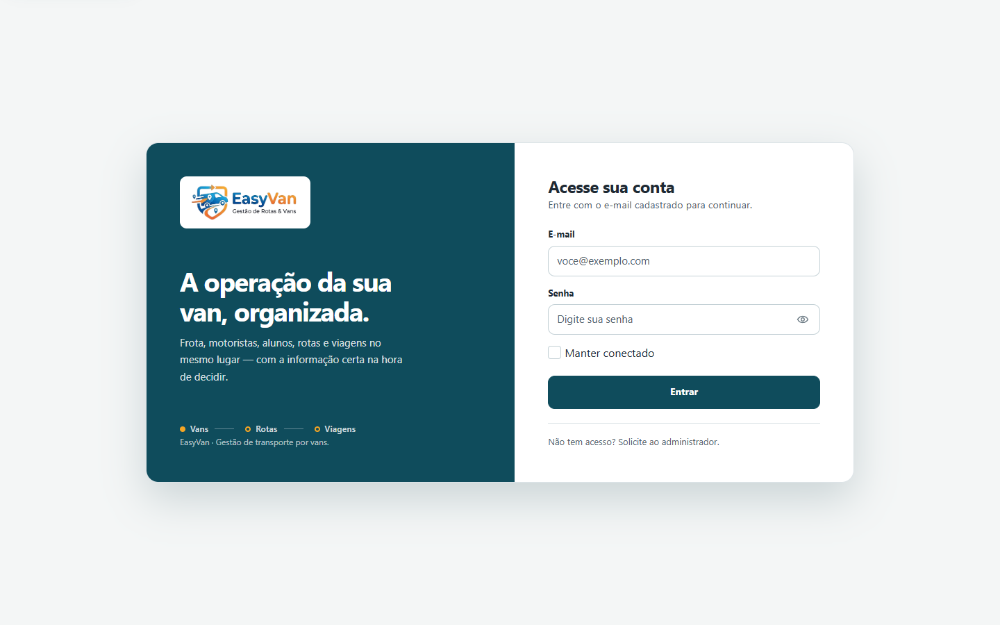
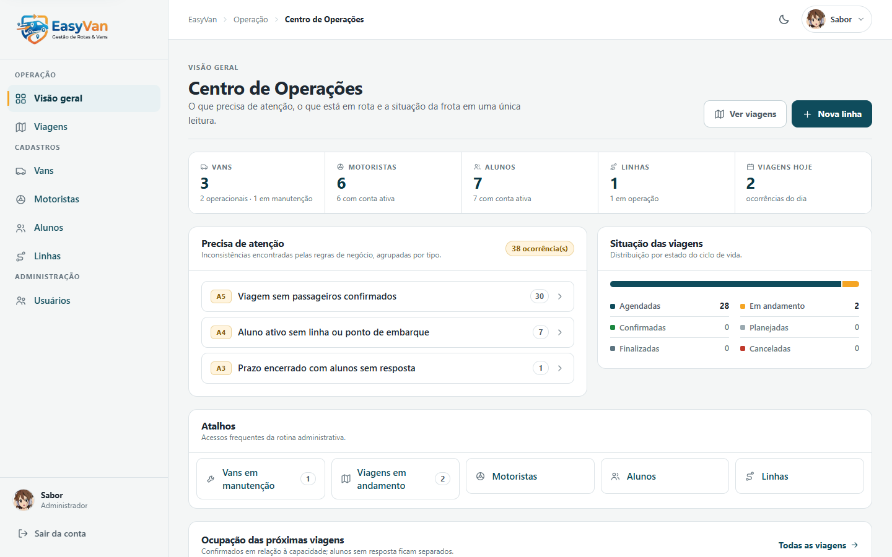
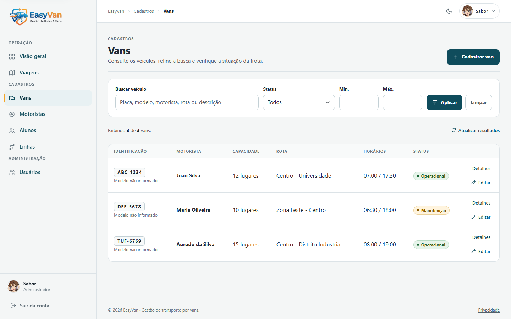
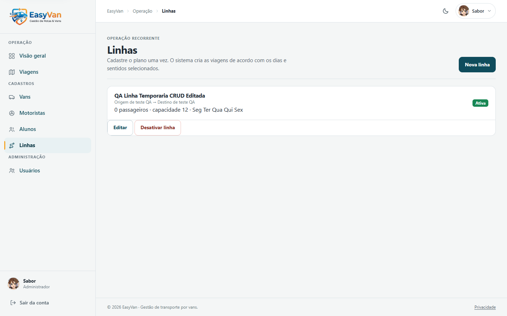
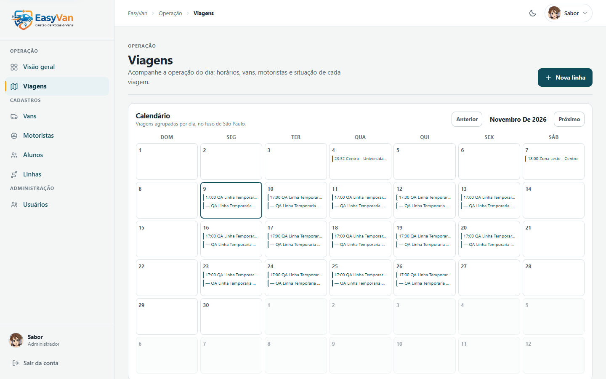

# EasyVan

Sistema web para gerenciamento de transporte por vans. O EasyVan centraliza o gerenciamento de vans, motoristas, alunos, rotas, viagens, presenças e contas de acesso em uma aplicação desenvolvida com ASP.NET Core MVC.

## O problema

Escolas, universidades e empresas que contratam transporte por van costumam organizar a operação em grupos de mensagens: quem vai em cada horário, qual aluno faltou, qual van está em manutenção e quem é o motorista do dia. Essa informação fica dispersa, desatualizada e sem histórico, o que provoca van lotada, aluno esquecido no ponto e viagem sem motorista.

## A solução

O EasyVan concentra o cadastro (vans, motoristas, alunos e linhas recorrentes) e a operação diária em um único sistema:

- o administrador cadastra a estrutura e acompanha a operação pelo Centro de Operações;
- o aluno confirma ou cancela a presença dentro do prazo definido;
- o motorista consulta a lista de passageiros por ponto de embarque e abre a rota no Google Maps.

## Objetivo do projeto

O EasyVan foi desenvolvido como trabalho acadêmico. O objetivo é aplicar, em um domínio real, os conceitos de modelagem de dados, CRUD com persistência, autenticação e autorização por perfil, regras de negócio em serviços e interface web responsiva.

## Estado atual

O projeto está funcional para desenvolvimento local e possui as seguintes funcionalidades:

- Login por cookie e autorização baseada em papéis.
- Perfis de Administrador, Motorista e Aluno.
- CRUD administrativo de usuários, vans, motoristas, alunos e linhas recorrentes.
- Geração automática de viagens a partir de linhas, com transições de estado e acompanhamento.
- Ciclo de vida formal das viagens: Planejada → Confirmada → Em andamento → Finalizada, com possibilidade de cancelamento.
- Validação de transições de estado no backend, impedindo alterações inválidas.
- Validadores operacionais centralizados: identificação de conflitos de horários entre motoristas e vans, capacidade excedida, viagens sem motorista ou veículo e dados inconsistentes.
- Registro de presença dos alunos nas viagens.
- Confirmação de presença pelos alunos: opções "Vou" e "Não vou" nas viagens agendadas.
- Registro de presença pelo motorista: marcação de alunos como Presentes ou Ausentes durante viagens em andamento.
- Busca e filtros combináveis de vans por texto, status e capacidade.
- Centro de Operações: painel administrativo com indicadores reais, alertas operacionais, ações prioritárias e atividades recentes.
- Histórico de auditoria: registro de operações relevantes, como criação, atualização, mudança de estado, cancelamento e registro de presença.
- Persistência com Entity Framework Core: SQLite no desenvolvimento local e PostgreSQL (Supabase) em produção.
- Armazenamento de senhas com hash PBKDF2 por meio de `IPasswordService`.
- Perfil de usuário com edição de nome, e-mail e foto.
- Tema claro e escuro, com preferência persistida.
- Criação de contas restrita ao Administrador, com perfil operacional de Aluno ou Motorista criado ou vinculado na mesma transação.
- Modelo operacional baseado em linhas recorrentes, organização e controle explícito de presenças.
- Gerenciamento de linhas com pontos operacionais de embarque e alocação manual por van e motorista.
- Geração diária idempotente de viagens e registros de presença para uma janela configurável, com padrão de 14 dias úteis.
- Confirmação ou cancelamento pelo aluno dentro dos prazos estabelecidos: ida até as 21h do dia anterior e volta até duas horas antes da saída. O servidor bloqueia respostas fora desses limites.
- Interface Razor responsiva, desenvolvida com Bootstrap, jQuery e CSS próprio.
- Painel do motorista organizado por pontos de embarque, com passageiros pendentes separados e links segmentados do Google Maps.
- Integração com Google Maps, incluindo roteirização no servidor e alternativa aproximada quando não há chave de API.
- Imagem Docker preparada para publicação; o contêiner escuta a porta informada em `PORT` (fallback `8080`), como no Railway.

O produto ainda não implementa GPS em tempo real, reservas, pagamentos, notificações ou gerenciamento de múltiplas organizações pela interface.

O schema operacional inclui `OrganizacaoId` e filtros globais por organização. O banco de desenvolvimento preserva o registro local existente e recebe alterações por meio de migrations. Não recrie o arquivo SQLite.

A geração automática cria viagens para as linhas ativas dentro de um horizonte de 14 dias úteis. Os prazos de confirmação ficam definidos em `PrazoPresenca`.

## Centro de Operações

O painel administrativo (`/Home/Administrador`) funciona como um centro de acompanhamento operacional e apresenta:

- Visão geral: quantidade de vans, motoristas, alunos, linhas recorrentes e viagens do dia.
- Situação das viagens: distribuição por estado (Planejada, Confirmada, Agendada, Em andamento, Finalizada e Cancelada).
- Alertas operacionais A1–A6: capacidade excedida, atribuições ausentes, prazos sem resposta, alunos sem ponto operacional, viagens sem passageiros confirmados e vans indisponíveis.
- Ações prioritárias: atalhos para vans em manutenção, viagens em andamento, resolução de alertas e gerenciamento de cadastros.
- Atividade recente: operações registradas no histórico de auditoria, com data, responsável e descrição.

Todos os indicadores utilizam dados reais do banco de dados.

## Capturas de tela

**Tela de entrada**



**Centro de Operações (Administrador)**



**Cadastro de vans com busca e filtros**



**Linhas recorrentes**



**Viagens**



## Tecnologia

- .NET 10 e ASP.NET Core MVC.
- Razor Views.
- Entity Framework Core 10.
- SQLite (desenvolvimento local) e PostgreSQL (produção via Supabase).
- Bootstrap e jQuery.
- xUnit para testes automatizados.
- Docker com imagens oficiais do .NET 10.

## Arquitetura

O EasyVan é uma aplicação MVC renderizada no servidor. O navegador recebe HTML, CSS e JavaScript estáticos; não existe API pública nem front-end separado.

```
Navegador (Razor + Bootstrap + jQuery)
        │  HTTP/HTTPS (cookie de autenticação)
        ▼
Controllers  ──►  Services (regras de negócio)
        │                 │
        ▼                 ▼
ViewModels/Views    EF Core DbContext
                          │
                SQLite (dev) │ PostgreSQL/Supabase (produção)
```

- **Controllers** validam a entrada, checam autorização e delegam a regra para os serviços. Não carregam regra de negócio.
- **Services** concentram validação operacional, geração de viagens, prazos de presença, roteirização, auditoria e o cálculo dos alertas A1–A6.
- **Data** contém o `ApplicationDbContext`, o seed (`DbInitializer`) e o `PostgresDatabaseBootstrapper`, que prepara o schema PostgreSQL no primeiro boot.
- **Models** reúne entidades e ViewModels; formulários nunca recebem entidades diretamente.
- Serviços hospedados (`GeracaoViagensHostedService` e `RoteirizacaoHostedService`) executam geração de viagens e recálculo de rotas em segundo plano.

Os dados são filtrados por `OrganizacaoId` por meio de filtro global no `DbContext`, e cada requisição revalida o usuário no banco antes de autorizar a ação.

## Pré-requisitos

- .NET SDK 10.
- Git, caso o projeto seja obtido por meio do repositório.
- Docker (opcional, para execução em contêiner).

Não é necessário executar `npm install`, pois o projeto não possui `package.json` e não utiliza Node.js como parte da aplicação principal.

## Executar localmente

Na raiz do projeto, execute:

```powershell
dotnet restore
dotnet build
dotnet test
dotnet run --launch-profile https
```

Acesse `https://localhost:7291` para entrar na aplicação.

O perfil também disponibiliza `http://localhost:5256`, mas o cookie de autenticação utiliza a configuração `Secure`. Portanto, o login só persiste quando a aplicação é acessada por HTTPS.

Na primeira inicialização local, a aplicação aplica as migrations do EF Core ao arquivo `easyvan.db` e cria dados de demonstração.

O banco local é um artefato de desenvolvimento e não deve ser versionado.

Em produção, com PostgreSQL, o bootstrapper gera o schema utilizando o provider Npgsql e registra o baseline das migrations históricas.

Se a porta padrão já estiver ocupada, encerre a outra instância do EasyVan ou inicie uma instância de desenvolvimento em outra porta:

```powershell
$env:ASPNETCORE_ENVIRONMENT = "Development"
dotnet run --no-launch-profile --urls http://localhost:5257
```

### Contas de demonstração

As contas abaixo são criadas somente quando `ASPNETCORE_ENVIRONMENT=Development`:

| Perfil        | E-mail                  | Senha    | Condição                             |
| ------------- | ----------------------- | -------- | ------------------------------------ |
| Administrador | `admin@easyvan.com`     | `123456` | Banco ainda sem usuários             |
| Motorista     | `motorista@easyvan.com` | `123456` | Banco ainda sem usuários             |
| Aluno         | `aluno@easyvan.com`     | `123456` | Banco ainda sem usuários             |
| Administrador | `email@email.com`       | `123456` | Criada se o e-mail ainda não existir |

Essas credenciais são exclusivas para demonstração local. Não as utilize em produção.

## Configuração

A conexão padrão é definida em `appsettings.json`:

```json
{
  "ConnectionStrings": {
    "DefaultConnection": "Data Source=easyvan.db"
  }
}
```

Em produção, no Railway, configure `ConnectionStrings__DefaultConnection` com a connection string PostgreSQL do Supabase.

O volume `/data` é opcional e persiste as chaves de proteção dos cookies; ele não armazena o banco PostgreSQL.

Em produção, prefira utilizar variáveis de ambiente:

```powershell
$env:ASPNETCORE_ENVIRONMENT = "Production"

$env:ConnectionStrings__DefaultConnection = "Host=...;Port=5432;Database=postgres;Username=...;Password=...;SSL Mode=Require"

$env:EASYVAN_ADMIN_EMAIL = "admin@exemplo.com"

$env:EASYVAN_ADMIN_PASSWORD = "defina-uma-senha-forte"

$env:GoogleMaps__ApiKey = "sua-chave-do-google-maps"

$env:GoogleMaps__BrowserApiKey = "chave-restrita-por-referenciador"
```

Quando o banco de produção estiver vazio, as variáveis `EASYVAN_ADMIN_EMAIL` e `EASYVAN_ADMIN_PASSWORD` permitem criar o primeiro administrador.

A aplicação não cria senhas padrão em produção.

A variável `GoogleMaps__ApiKey` (ou `GOOGLE_MAPS_API_KEY`) ativa a Routes API e a geocodificação no servidor.

A variável `GoogleMaps__BrowserApiKey` (ou `GOOGLE_MAPS_BROWSER_API_KEY`) ativa o preenchimento automático de endereços no navegador. Essa chave deve ser restrita por HTTP Referrer e pelas APIs habilitadas.

Utilize chaves separadas para navegador e servidor.

Os endereços podem ser salvos sem as chaves, mas o cálculo da rota exige pontos geolocalizados. Sem a chave do servidor, os pontos localizados podem utilizar a ordenação aproximada local.

Em produção, as chaves do ASP.NET Core Data Protection são gravadas em `/data/keys` quando o volume está montado. Sem volume, a aplicação usa um diretório gravável alternativo e registra um aviso; o efeito prático é que usuários precisam autenticar novamente após cada reinício.

## Hospedagem (Railway + Supabase)

O ambiente de produção combina o Railway (aplicação em contêiner) com o Supabase (PostgreSQL gerenciado). Os detalhes operacionais completos estão em [`docs/supabase-railway.md`](docs/supabase-railway.md).

**1. Banco no Supabase**

1. Crie o projeto e copie a connection string do **Session pooler** (IPv4). O transaction pooler não é compatível com o uso de `TimeSpan`/transações do EF Core neste projeto.
2. Use `SSL Mode=Require` e mantenha o usuário `postgres` apenas do lado do servidor.
3. Nada precisa ser criado à mão: no primeiro boot o `PostgresDatabaseBootstrapper` aplica o script do modelo, registra o baseline das migrations e habilita RLS com revogação de `anon`/`authenticated`.

**2. Aplicação no Railway**

| Variável | Obrigatória | Função |
|---|---|---|
| `ConnectionStrings__DefaultConnection` | sim | Connection string do Session pooler do Supabase. |
| `EASYVAN_ADMIN_EMAIL` / `EASYVAN_ADMIN_PASSWORD` | recomendada | Cria o primeiro administrador quando o banco está vazio. |
| `GoogleMaps__ApiKey` | opcional | Routes API e geocodificação no servidor. |
| `GoogleMaps__BrowserApiKey` | opcional | Preenchimento de endereços no navegador (restrita por referrer). |
| `ASPNETCORE_ENVIRONMENT` | sim | `Production`. |

- O contêiner escuta a porta definida em `PORT` (fallback `8080`), então o domínio do Railway deve apontar para a porta pública gerada.
- O volume `/data` é opcional: guarda as chaves de Data Protection. Sem volume, a aplicação usa o diretório de trabalho e avisa no log, em vez de falhar na inicialização.
- Nenhuma migration é aplicada destrutivamente: o bootstrapper apenas aplica o que falta e recusa iniciar se o schema público tiver tabelas sem histórico de migrations.

**3. Verificação após o deploy**

1. Acesse `/Usuarios/Login`; a página deve responder `200`.
2. Entre com o administrador criado pelas variáveis de ambiente.
3. Confirme em `/Home/Administrador` que os totais refletem o banco PostgreSQL.
4. Consulte os logs do Railway para confirmar que não houve exceção de inicialização.

## Docker

Para construir e executar a aplicação:

```powershell
docker build -t easyvan .

docker run --rm -p 8080:8080 `
  -e ASPNETCORE_ENVIRONMENT=Production `
  -e EASYVAN_ADMIN_EMAIL=admin@exemplo.com `
  -e EASYVAN_ADMIN_PASSWORD="defina-uma-senha-forte" `
  -e GoogleMaps__ApiKey="sua-chave-do-google-maps" `
  -v easyvan-data:/data `
  easyvan
```

Acesse `http://localhost:8080`.

O Dockerfile configura `ASPNETCORE_URLS=http://0.0.0.0:8080`.

## Estrutura do projeto

```
Controllers/     Fluxos MVC e regras de entrada
Data/            DbContext, inicialização e persistência
Models/          Entidades e ViewModels
Services/        Serviços de domínio (validação, auditoria, centro de operações, fotos e tema)
Views/           Views Razor da aplicação
Migrations/      Migrations do Entity Framework Core
tests/           Projeto de testes xUnit
wwwroot/         CSS, JavaScript, imagens e bibliotecas estáticas
spec/            Especificações funcionais
plan/            Planos de implementação e testes
```

## Testes e validação

O projeto de testes xUnit faz parte da solução. Portanto, `dotnet test` executa a suíte completa a partir da raiz:

```powershell
dotnet test
```

O projeto inclui 143 testes automatizados, que abrangem:

- Hash de senhas PBKDF2 (legado e atual).
- Validação de senhas (6 a 20 caracteres).
- Normalização de papéis de usuário.
- Regras operacionais: conflitos de horários entre motoristas e vans, capacidade excedida, viagens sem motorista ou van e dados inconsistentes.
- Transições válidas e inválidas do ciclo de vida das viagens.
- Validação de novas viagens, incluindo vans, motoristas e rotas inexistentes, além de conflitos.
- Agenda de viagens: datas e horários no passado, chegada anterior à partida, viagens que atravessam a meia-noite e fuso horário de São Paulo.
- Criação de viagens com registro de presenças, ordenação cronológica e separação entre horários previstos e reais.
- Criação e vinculação automática de perfis de Aluno e Motorista a partir da conta, incluindo conflitos de e-mail e de vínculo.
- Gerenciamento de vans: bloqueio de placas duplicadas, exigência de motorista e rota, modelo obrigatório no formulário, busca com um caractere e identificação por placa e modelo.
- Estados da interface, incluindo rótulos e classes CSS.
- Validação brasileira de telefone e CNH.

A compilação também valida as Views Razor.

## Segurança

- Senhas novas são armazenadas com hash PBKDF2-SHA256 (600.000 iterações), nunca em texto simples; hashes antigos são reescritos no próximo login.
- A regra de senha é de 6 a 20 caracteres, validada no servidor e no formulário.
- A autenticação utiliza cookies com HttpOnly, Secure e SameSite Lax, expiração deslizante de 8 horas e revalidação do usuário no banco a cada requisição.
- "Manter conectado" grava um cookie persistente de até 30 dias; sem a opção, a sessão termina com o navegador.
- Ações administrativas exigem o papel de Administrador no backend.
- Somente o Administrador cria contas; não existe cadastro público nem link de cadastro na tela de entrada.
- Um administrador não pode excluir a própria conta nem outro administrador.
- Motoristas só podem operar suas próprias viagens.
- Alunos só podem confirmar presença em suas próprias viagens.
- Proteção antiforgery em todos os formulários POST.
- Rate limiting nos endpoints de login.
- Segredos de produção devem ser fornecidos por variáveis de ambiente.
- Não versione `easyvan.db`, tokens, senhas ou chaves do Data Protection.
- O envio de fotos valida o tipo de arquivo (JPEG, PNG ou WebP) e o tamanho máximo de 2 MB, utilizando nomes não previsíveis.

Consulte [SECURITY.md](SECURITY.md) para conhecer os controles de segurança, as limitações conhecidas e as responsabilidades de implantação.

## Documentação do projeto

- [Direção de produto](PRODUCT.md)
- [Sistema visual](DESIGN.md)
- [Acessibilidade](ACCESSIBILITY.md)
- [Contribuição](CONTRIBUTING.md)
- [Privacidade](PRIVACY.md)
- [Segurança](SECURITY.md)
- [Especificação de filtros](spec/filtros-e-busca.md)
- [Plano de testes](plan/03-plano-de-testes.md)
- [Relatório da Fase 6: produto, concorrência, LGPD e piloto](docs/fase-6-relatorio-final.md)
- [Registro de prompts de IA](docs/prompts-ia.md)

## Equipe

- Guilherme Pereira Andraz
- Davi Gato Grijó da Silva
- Victor Hugo Volpi Pereira
- Caio Candiani Regio
- Pedro Ailton dos Santos Cavalieri
- Enzo Miguel Bertoluci Ovido

## Licença

Atualmente, o projeto não possui uma licença open source definida. Consulte LICENSE antes de redistribuir ou reutilizar o código.

## Banco de dados e migrations PostgreSQL

A aplicação utiliza SQLite exclusivamente no desenvolvimento local. Em produção, o banco de dados é PostgreSQL via Supabase, utilizando o provider `Npgsql.EntityFrameworkCore.PostgreSQL` do EF Core.

- Configure `ConnectionStrings__DefaultConnection` com uma connection string PostgreSQL válida e TLS habilitado.
- O bootstrapper PostgreSQL cria um schema vazio utilizando o DDL gerado pelo modelo Npgsql e registra o baseline das migrations legadas. Esse processo não executa SQL SQLite nesse ambiente.
- As migrations devem permanecer compatíveis com os diferentes providers: não fixe `INTEGER` ou `TEXT` em `table.Column`, não utilize `AUTOINCREMENT` fora do ramo SQLite e não utilize `COLLATE NOCASE` no PostgreSQL.
- Colunas de chave primária do tipo `int` utilizam `ValueGeneratedOnAdd`. No PostgreSQL, o provider Npgsql gera `GENERATED BY DEFAULT AS IDENTITY`. Não atribua IDs manualmente nos dados de seed.
- Antes de publicar novas migrations, gere e revise o script PostgreSQL e execute os testes de integração com PostgreSQL.

Consulte [`docs/database-postgresql.md`](docs/database-postgresql.md) para obter informações sobre configuração, testes e procedimentos seguros de atualização.

## Linhas recorrentes e roteirização

O fluxo recomendado consiste em cadastrar uma Linha uma única vez em `/Linhas/Create`, informando nome, origem, destino, dias de operação, horário de chegada na ida, horário de saída na volta, sentidos, alunos e alocação manual de alunos por van e motorista.

O sistema gera ocorrências diárias para até 14 dias úteis e inicializa a presença dos alunos com o status `SemResposta`.

A capacidade é validada tanto por van quanto no conjunto das alocações.

A roteirização utiliza somente os pontos operacionais dos alunos confirmados. O sistema calcula e armazena a ordem e o tempo estimado de chegada (ETA), reutilizando o resultado enquanto o hash do conjunto de pontos não for alterado.

Endereços residenciais não são utilizados como alternativa para a rota.

Quando `GoogleMaps__ApiKey` está configurada, o sistema utiliza a Routes API. Sem a chave, utiliza um roteirizador local aproximado e exibe um aviso.

O motorista recebe os passageiros agrupados por ponto, com os pendentes em uma seção separada e links segmentados do Google Maps, limitados a três waypoints móveis por trecho.

Consulte [`spec/fase-4-rotas-do-motorista.md`](spec/fase-4-rotas-do-motorista.md).

O painel administrativo exibe a ocupação das próximas viagens e os alertas A1–A6, com regras centralizadas no serviço operacional e cobertas por testes automatizados.

Consulte [`spec/fase-5-alertas-e-ocupacao.md`](spec/fase-5-alertas-e-ocupacao.md).

As tabelas legadas de Rota, Parada e Agenda permanecem no sistema para garantir compatibilidade histórica.

Viagens vinculadas a uma Linha não podem ser criadas nem editadas manualmente.

A migration `LinhasRecorrentesRoteirizacao` preserva o SQLite existente e deve ser aplicada ao reiniciar a aplicação.

O isolamento por `OrganizacaoId` é aplicado por meio de filtros globais nas entidades operacionais.

Consulte `spec/linhas-recorrentes-e-roteirização.md` e `docs/google-maps.md` para conhecer as regras, os limites, os preços e as decisões pendentes.

O fluxo atual é baseado em Linhas recorrentes, com geração automática de viagens para 14 dias úteis e filtros por organização.
